<!--  -->

  

---

###  `WHOAMI`
---

  

---

###   `Code_Dna`
---

  

##

###  `FEATURED_REPOSITORIES`
---

 

| 🎬 | 🍔 | 🧠 |
|----|----|----|
|  |  |  |

| 🤖 | 🏦 | 🧑‍🎓 |
|----|----|----|
|  |  |  |

 

**[→ view all repositories](https://github.com/soumensen411?tab=repositories)**

---

###  ` LANGUAGES_AND_TOOLS`
---

<table>
  <tr>
    <td align="left" colspan="6">
      <b>🧠 Data Science</b>
    </td>
  </tr>
  <tr>
    <td align="center">
       Numpy
    </td>
    <td align="center">
       Pandas
    </td>
    <td align="center">
       Matplotlib
    </td>
    <td align="center">
       Seaborn
    </td>
    <td align="center">
       Scipy
    </td>
    <td align="center">
       Sklearn
    </td>
  </tr>
</table>

 

<table>
  <tr>
    <td align="left" colspan="10">
      <b>🌐 Web Development</b>
    </td>
  </tr>
  <tr>
    <td align="center">
       HTML5
    </td>
    <td align="center">
       CSS3
    </td>
    <td align="center">
       Javascript
    </td>
    <td align="center">
       Tailwind
    </td>
    <td align="center">
       DaisyUI
    </td>
    <td align="center">
       React
    </td>
    <td align="center">
       Django
    </td>
    <td align="center">
       Flask
    </td>
    <td align="center">
       Vite
    </td>
    <td align="center">
       GSAP
    </td>
  </tr>
</table>

 

<table>
  <tr>
    <td align="left" colspan="3">
      <b>💻 Programming Languages</b>
    </td>
  </tr>
  <tr>
    <td align="center">
       Python
    </td>
    <td align="center">
       C++
    </td>
    <td align="center">
       C
    </td>
  </tr>
</table>

 

<table>
  <tr>
    <td align="left" colspan="6">
      <b>🛠️ Tools & Others</b>
    </td>
  </tr>
  <tr>
    <td align="center">
       Git
    </td>
    <td align="center">
       VS Code
    </td>
    <td align="center">
       Postman
    </td>
    <td align="center">
       Arduino
    </td>
    <td align="center">
       MongoDB
    </td>
    <td align="center">
       Firebase
    </td>
  </tr>
</table>

---

###   ` Contact With Me`

---

 

<table>
  <tr>
    <td align="center" width="130">
      
    </td>
    <td align="center" width="130">
      
    </td>
    <td align="center" width="130">
      
    </td>
    <td align="center" width="130">
      
    </td>
  </tr>
  <tr>
    <td align="center" width="130">
      
    </td>
    <td align="center" width="130">
      
    </td>
    <td align="center" width="130">
      
    </td>
    <td align="center" width="130">
      
    </td>
  </tr>
</table>

 

---

